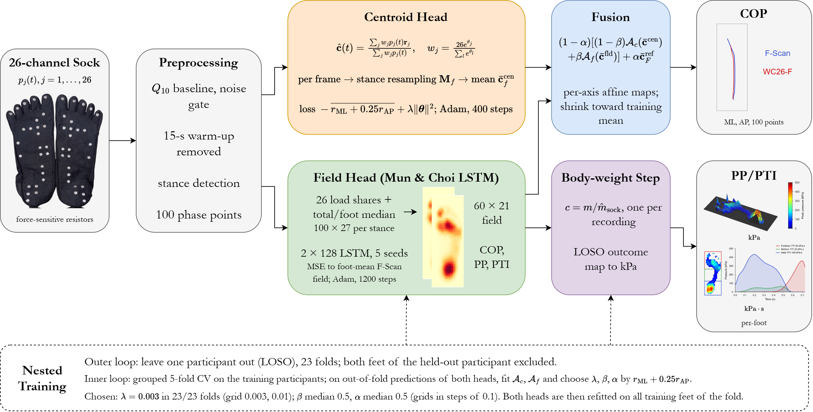

# WC26-F

**WC26-F: From High-Density Plantar Pressure Mapping to a Smart Sock for Center-of-Pressure Trajectories, Peak Pressure, and Pressure–Time Integral During Walking**

- The official PyTorch implementation of WC26-F and of the agreement benchmark used in the paper.
- The paper is currently under review; the citation will be added on publication.
- The code reproduces every analysis of the paper from the raw recordings: the private-cohort benchmark against F-Scan and the StepUP-P150 benchmark.

## Abstract

Peak pressure (PP) and pressure–time integral (PTI) mark plantar ulcer risk in diabetes, and a sock that tracks them together with the center of pressure (COP) could support daily monitoring. We compare a 26-channel sensorized sock with the F-Scan in-shoe pressure system and propose WC26-F, a decoder that fuses a weighted-centroid head, trained on the evaluated COP trajectory, with a long short-term memory (LSTM) pressure-field head. All model selection is nested inside leave-one-participant-out cross-validation. Twelve published sensor layouts, including the SmartSox optical-fiber sock, and two published decoders are adapted to the same sock and scored with the same statistics: COP correlation, root-mean-square error, two-dimensional COP distance and repeated-measures Bland–Altman limits for COP, and correlation, ICC(A,1) and RMSE for PP and PTI after a body-weight step calibration. The same methods are run on the public StepUP-P150 dataset, where the sock is sampled from the high-density runway field.



## Table of Contents

- [Requirements](#requirements)
- [Installation](#installation)
- [Dataset](#dataset)
- [Usage](#usage)
- [Configuration](#configuration)
- [Repository Structure](#repository-structure)
- [Acknowledgements](#acknowledgements)

## Requirements

- Python 3.12
- PyTorch 2.13 (CUDA 12.6 build used for the paper; CPU also works, slower)
- numpy, pandas, scipy, scikit-learn (versions in `requirements.txt`)
- NVIDIA GPU recommended for the LSTM and cGAN decoders

## Installation

```bash
# 1. Clone the repository
git clone <repository-url>
cd WC26-F

# 2. Create and activate an environment
conda create --name wc26f python=3.12
conda activate wc26f

# 3. Install PyTorch (CUDA 12.6 shown; pick the build for your machine)
pip install torch==2.13.0 --index-url https://download.pytorch.org/whl/cu126

# 4. Install the remaining dependencies
pip install -r requirements.txt
```

## Dataset

### Private cohort (sock and F-Scan)

The recordings of the private cohort contain personal data and are not distributed with this repository. The code expects them under `data/` (or the folder named by `PPS_DATA_DIR`):

```
data/
├── dataset_config.json          # participant aliases and recording-set choices (see configs/)
├── participants.csv             # subject, sex, age, height_cm, mass_kg (body mass is required)
└── <group>/                     # any grouping folder, e.g. by sex
    ├── f_scan/<subject>/onlyFscan_L.csv, onlyFscan_R.csv, Mix_L.csv, ...
    └── sock/<subject>/onlySock_L.csv, onlySock_R.csv, Mix_L.csv, ...
```

- The file suffix `_L` / `_R` gives the foot. Files starting with `only` are separate recordings; `Mix` means both devices were worn at the same time.
- F-Scan files are Tekscan movie exports (`DATA_TYPE MOVIE`, 60 × 21 sensels in kPa).
- Sock files are CSV with a `Time(ms)` column and channels `Data1` … `Data26`.
- Both feet of a participant are held out together in every cross-validation fold; folders of one participant recorded more than once are joined through `participant_aliases`.

### StepUP-P150

Download [StepUP-P150](https://doi.org/10.20383/103.01285) and extract it to `StepUP-P150_dataset/` (or the folder named by `PPS_STEPUP_DIR`). The code reads `participant_metadata.csv` and `py/<participant>/<footwear>/<speed>/{trial.npz, metadata.csv}`.

## Usage

Every step is a command of `main.py`. Run the private-cohort steps in order; each one reads the previous output.

### Private cohort

```bash
sh run_private.sh
```

or step by step:

```bash
# 1. F-Scan reference: per-foot mean COP trajectory and mean pressure field (run once)
python main.py prepare

# 2. COP benchmark: WC26-F, its two heads and 16 comparators, physical and virtual routes
python main.py physical
python main.py physical --skip-deep                       # without the LSTM / cGAN / deep forest
python main.py physical --methods "WC26-F (ours)"          # selected methods only, merged into existing CSVs

# 3. PP and PTI agreement, with and without the body-weight step calibration
python main.py pressure --n-boot 2000

# 4. Simultaneous (Mix) recordings: step-paired agreement
python main.py mix
```

### StepUP-P150

```bash
sh run_stepup.sh
```

or:

```bash
# all 12 conditions (BF / ST / P1 / P2 x W1 / W3 / W4), participant-grouped 5-fold CV
python main.py stepup

# a quick check on six participants, barefoot, preferred speed, fast methods only
python main.py stepup --footwear BF --speeds W1 --limit-subjects 6 --skip-deep

# 26-site PP / PTI ceiling (reads the extraction cache of the previous command)
python main.py stepup-ceiling
```

Each module can also be run on its own, e.g. `python -m experiments.cop_benchmark --help`.

### Outputs

Everything is written to `results/` (or `PPS_OUT_DIR`):

| File | Content |
|------|---------|
| `baseline_cop_{physical,virtual}.csv` | COP agreement per method |
| `baseline_scalar_{physical,virtual}.csv` | PP / PTI agreement per method |
| `baseline_per_foot_{physical,virtual}.csv` | per subject-foot values |
| `baseline_trajectories_{physical,virtual}.npz` | held-out mean COP trajectories |
| `wc26f_folds.csv` | WC26-F choices (λ, β, α) and centroid weights per outer fold |
| `pressure_validation/` | PP and PTI tables |
| `public_baselines/` | StepUP-P150 tables per condition |

## Configuration

`config.py` holds the processing constants; paths can be redirected with environment variables:

| Variable | Default | Meaning |
|----------|---------|---------|
| `PPS_DATA_DIR` | `./data` | private cohort recordings |
| `PPS_STEPUP_DIR` | `./StepUP-P150_dataset` | StepUP-P150 root |
| `PPS_OUT_DIR` | `./results` | outputs and caches |

Key settings in `config.py`:

- Sock cleaning: per-channel Q10 baseline, 3σ noise gate, floor 18 000.
- F-Scan cleaning: cells below 20 kPa set to 0.
- First 15 s of every recording discarded; stances detected from total and heel load; 100 phase points per stance.
- `SOCK_COORDS_FULL`: the 26 sensor positions on the 60 × 21 F-Scan grid.

`model/wc26f.py` holds the WC26-F settings (`LAMBDAS`, `BETAS`, `ALPHAS`, `AP_WEIGHT`, `STEPS`, `SEEDS`, `INNER_K`), and `model/layouts.py` the published sensor layouts with their sources. `configs/fscan_reference_footprint.json` is the mean F-Scan footprint used to register StepUP-P150 footsteps.

## Repository Structure

```
├── main.py                      # entry point
├── config.py                    # paths, constants, cleaning, stance detection, trial discovery
├── configs/                     # footprint box, example dataset config and participant table
├── data_loader/                 # F-Scan and sock parsers, reference preparation, StepUP-P150 loading
├── model/                       # WC26-F, published layouts, linear decoder
├── experiments/                 # COP benchmark, PP / PTI validation, Mix validation, StepUP-P150
├── utils/                       # agreement statistics, resampling
├── run_private.sh
└── run_stepup.sh
```

## Acknowledgements

- [StepUP-P150](https://doi.org/10.20383/103.01285) (Larracy et al., *Scientific Data* 12, 1415, 2025, [doi:10.1038/s41597-025-05792-1](https://doi.org/10.1038/s41597-025-05792-1)) for the public high-density plantar pressure dataset (CC BY 4.0).
- The authors of the published sensor layouts and decoders reproduced in `model/layouts.py` and `experiments/cop_benchmark.py`.
